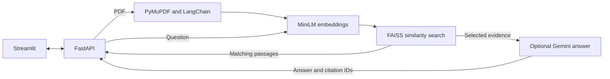

# DocQuery - AI Document Assistant

DocQuery helps you find answers in PDFs and check the page behind each answer. Upload a document, ask a question, and open the matching passage. It supports local semantic search and optional Gemini answers with page citations.

**Built with** Python, FastAPI, Streamlit, LangChain, Sentence Transformers, FAISS, PyMuPDF, and Google Gemini.

## One-minute demo

1. Run the app and generate the fictional sample PDFs using the commands below.
2. Add **Orbit Employee Handbook.pdf** in the **Documents** sidebar.
3. Ask **How much annual leave do employees get?** The top match is **20 days** on **page 1**. Choose **Find passages** for local search or **Ask Gemini** for a cited answer when a Gemini key is configured.

## How it works



DocQuery keeps page numbers as it splits PDF text into overlapping passages. MiniLM turns each passage and question into a 384-dimensional vector. FAISS ranks passages by cosine similarity. In answer mode, DocQuery sends relevant passages to Gemini and checks its citation IDs against the evidence. The interface shows matching passages if Gemini is unavailable. Similarity scores measure closeness in meaning.

## Run locally

Use 64-bit Python 3.10. From the project folder in Windows Git Bash, install dependencies and generate the fictional sample PDFs.

```bash
python -m venv .venv
./.venv/Scripts/python.exe -m pip install -r requirements.txt
./.venv/Scripts/python.exe examples/create_demo_pdfs.py
```

Run FastAPI in one terminal and Streamlit in another.

```bash
# Terminal 1
./.venv/Scripts/python.exe -m uvicorn docquery.api:app --host 127.0.0.1 --port 8000
# Terminal 2
./.venv/Scripts/python.exe -m streamlit run streamlit_app.py --server.address 127.0.0.1
```

Open [DocQuery](http://127.0.0.1:8501) and select a PDF from `examples/output/`. On macOS or Linux, use `.venv/bin/python` for the same commands. MiniLM downloads on first use.

For optional Gemini answers, copy `.env.example` to `.env`, set `GEMINI_API_KEY` on the server, and restart FastAPI. **Ask Gemini** sends the question and selected passage text to Google. **Find passages** runs locally.

## API and tests

[Swagger UI](http://127.0.0.1:8000/docs) documents the API while the server is running.

| Endpoint | Purpose |
| --- | --- |
| `GET /health` | Check service status and whether Gemini is configured |
| `POST /upload` | Index PDFs |
| `POST /ask` | Retrieve passages and optionally generate an answer |
| `GET /documents` | List indexed PDFs |
| `DELETE /documents/{document_id}` | Remove one PDF from search |
| `DELETE /documents` | Clear the workspace |

Run `./.venv/Scripts/python.exe -m pytest -q` for the default suite. To include the real embedding model test, prefix the command with `DOCQUERY_TEST_MODEL=1` in Git Bash.

## Project scope

The workspace is designed for local, single-user use. The in-memory index resets when FastAPI restarts. PDFs need selectable text.

## Credits

LangChain's MIT-licensed RAG tutorial, copyright 2025 LangChain, served as a design reference. [RAG tutorial example](https://github.com/langchain-ai/docs/blob/main/src/code-samples/langchain/rag.py) / [Upstream license](https://github.com/langchain-ai/docs/blob/main/LICENSE)

PyMuPDF is available under AGPLv3 or a commercial license. [PyMuPDF licensing](https://pymupdf.io/licensing)
